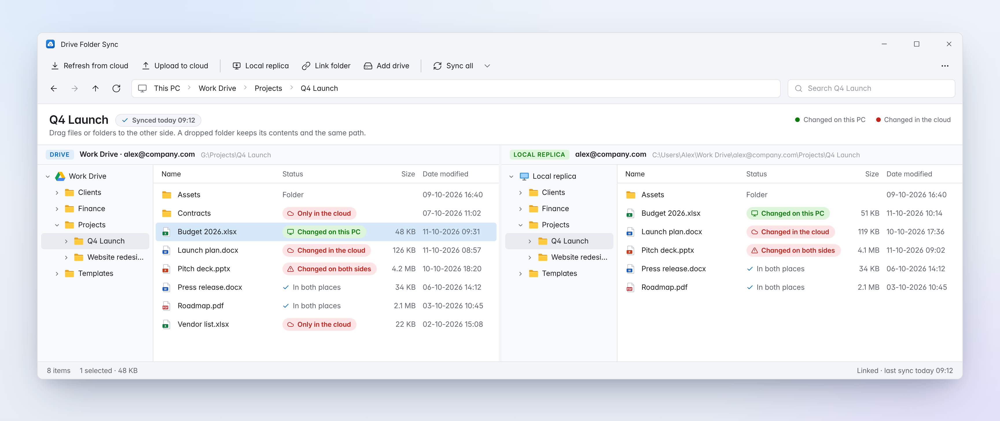
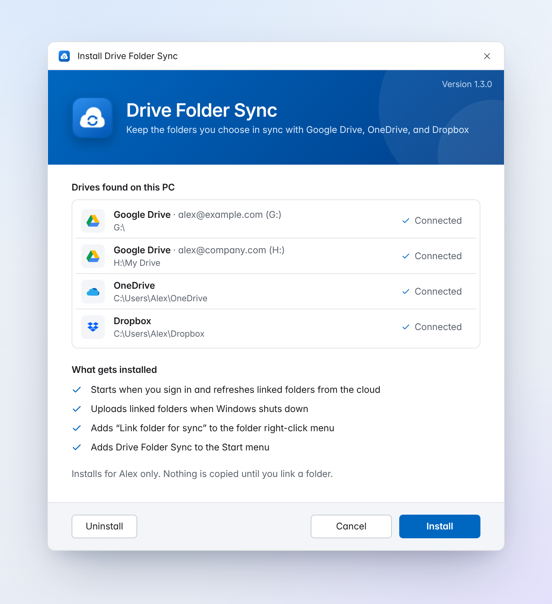
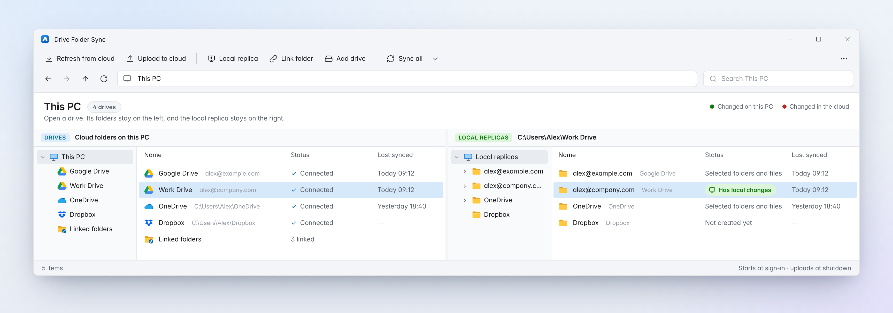

<div align="center">


# Drive Folder Sync

**A two-pane File Explorer for your cloud drives.**<br>
Browse Google Drive, OneDrive, Dropbox, or any cloud folder on the left, and keep a local replica of just the parts you need on the right.

[](https://github.com/sb-git-cs/drive-folder-sync/releases/latest)


[](LICENSE)

[Download](https://github.com/sb-git-cs/drive-folder-sync/releases/latest) · [Features](#features) · [How it works](#how-it-works) · [Build from source](#build-from-source)

<br>



</div>

## Features

| | |
| --- | --- |
| **Side-by-side panes** | The drive and its local replica follow the same folder, so a drop always lands on the matching path. |
| **Selective replica** | Copy only the folders and files you pick. Nothing is copied until you ask. |
| **Clear sync status** | Green means changed on this PC. Red means changed in the cloud or on both sides. A **Last synced** column shows when each item was last in sync. |
| **Hands-off sync** | Linked folders refresh from the cloud at sign-in and upload back at shutdown. |
| **Explorer integration** | A **Link folder for sync** entry in every folder's right-click menu. |
| **Works with any cloud folder** | Google Drive, OneDrive, and Dropbox are detected automatically. **Add drive** attaches anything else. |

## Install

1. Download **[DriveFolderSyncSetup.exe](https://github.com/sb-git-cs/drive-folder-sync/releases/latest)**.
2. Run it. The installer lists the drives it found and what it will set up.
3. Choose **Install**.

<p align="center"></p>

The install is per user (no admin rights) and lives in `%LOCALAPPDATA%\DriveFolderSync`. To update, run a newer installer and choose **Reinstall**.

## How it works

Open a drive from **This PC**. Each drive appears next to its local replica, which lives under your `Work Drive` folder using the same relative paths as the cloud.



| Action | Result |
| --- | --- |
| **Drag** a file or folder to the other pane | Copied to the same path. Folders keep their contents. |
| **Local replica** | Copies the selection. Parent folders are created so the path matches. |
| **Link folder** | Adds the selection to the sign-in refresh and the shutdown upload. |
| **Sync all** | Refreshes or uploads every linked folder on demand. |

A drive can be browsed as soon as it is on the PC. It joins sync once you link a folder or drop files into its replica.

## Keyboard shortcuts

| Keys | Action |
| --- | --- |
| <kbd>Alt</kbd>+<kbd>←</kbd>, <kbd>Backspace</kbd> | Back |
| <kbd>Alt</kbd>+<kbd>→</kbd> | Forward |
| <kbd>Alt</kbd>+<kbd>↑</kbd> | Parent folder |
| <kbd>F5</kbd> | Refresh |
| <kbd>Ctrl</kbd>+<kbd>F</kbd> | Search this folder |
| <kbd>Ctrl</kbd>+<kbd>L</kbd>, <kbd>Alt</kbd>+<kbd>D</kbd> | Type a path |
| <kbd>Ctrl</kbd>+<kbd>A</kbd> | Select all |

Click any part of the address bar to jump there, or the empty space to type a path. Right-click an item for Open, Show in File Explorer, Copy path, and the sync commands. Uninstall, logs, and About are under **⋯**.

## Build from source

Requires Windows with .NET Framework 4.8. No other SDK is needed.

```powershell
powershell -NoProfile -ExecutionPolicy Bypass -File .\build.ps1
```

The installer is written to `dist\DriveFolderSyncSetup.exe`. Run `DriveFolderSyncSetup.exe /selftest` to check the sync rules without touching your drives.

<details>
<summary>Regenerating the README screenshots</summary>

The screenshots are rendered from HTML mockups in [`docs/screenshots/src`](docs/screenshots/src) so they stay crisp and free of personal data:

```sh
npm i -g playwright && NODE_PATH=$(npm root -g) node docs/screenshots/src/render.js
```
</details>

## License

[MIT](LICENSE)
